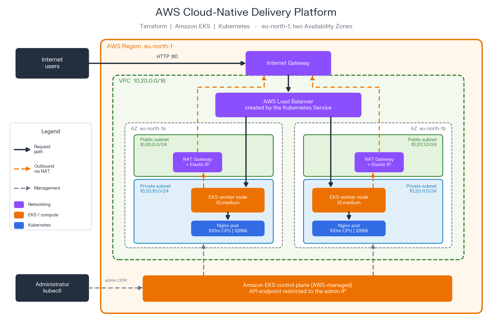
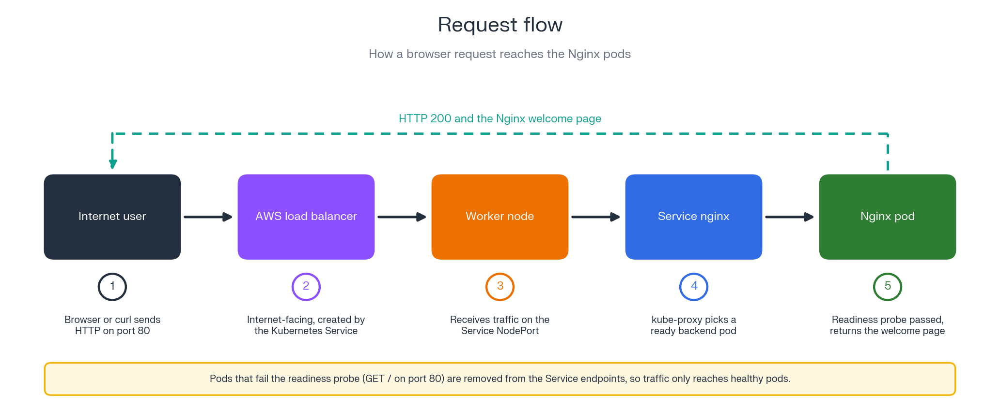
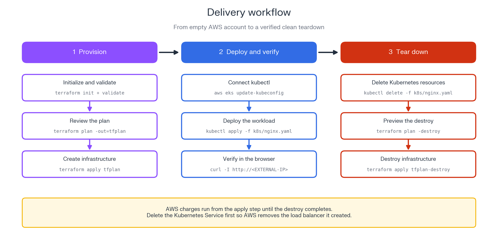

# AWS Cloud-Native Delivery Platform

Infrastructure as Code project that provisions an Amazon EKS environment on AWS with Terraform and runs a resource-limited, health-checked Nginx workload on it with Kubernetes.


> **Cost note:** This environment was built for testing. The cluster, NAT Gateways, and worker nodes bill hourly while running, so everything was destroyed after validation. See [Cleanup](#cleanup).

## Table of contents

- [Architecture](#architecture)
- [What this project demonstrates](#what-this-project-demonstrates)
- [Repository structure](#repository-structure)
- [Prerequisites](#prerequisites)
- [Deployment](#deployment)
- [Configuration](#configuration)
- [Verification](#verification)
- [Verified results](#verified-results)
- [Design decisions](#design-decisions)
- [Known limitations](#known-limitations)
- [Cleanup](#cleanup)
- [Key takeaways](#key-takeaways)
- [Troubleshooting](#troubleshooting)
- [Roadmap](#roadmap)

## Architecture

### Infrastructure overview



### Request flow



### Delivery workflow



## What this project demonstrates

- Terraform-managed AWS networking: VPC, public and private subnets across two Availability Zones, route tables, Internet Gateway, NAT Gateways, Elastic IPs, and security groups.
- An Amazon EKS cluster with a managed node group in private subnets.
- IAM roles and AWS-managed policies for the control plane and worker nodes.
- EKS access entries that grant cluster-admin access to a specific IAM user.
- A Kubernetes Deployment with two replicas, resource requests and limits, and readiness and liveness probes.
- Public exposure through a `LoadBalancer` Service.
- A safe teardown process: delete the Kubernetes load balancer first, then review a saved destroy plan before applying it.

## Repository structure

```text
.
├── .github/
│   └── workflows/
│       └── terraform-ci.yml     # fmt check, init, and validate on every push and PR
├── k8s/
│   └── nginx.yaml               # Deployment and LoadBalancer Service
├── docs/
│   └── images/                  # Exported diagrams
├── network.tf                   # VPC, subnets, route tables, Internet Gateway, NAT Gateways
├── security.tf                  # Security groups
├── iam.tf                       # IAM roles and policy attachments
├── eks.tf                       # EKS cluster, node group, access entries
├── variables.tf                 # Input variables
├── locals.tf                    # Shared locals such as common tags
├── providers.tf                 # AWS provider configuration
├── versions.tf                  # Terraform and provider version constraints
├── outputs.tf                   # Infrastructure and cluster outputs
├── backend.tf.example           # Optional S3 remote state template
├── terraform.tfvars.example     # Template for local settings
├── .terraform.lock.hcl          # Pinned provider versions
├── .gitignore                   # Excludes tfvars, state, and plan files
├── LICENSE
└── README.md
```

## Prerequisites

- An AWS account and an IAM identity that can create VPC, EKS, and IAM resources
- [AWS CLI](https://docs.aws.amazon.com/cli/latest/userguide/getting-started-install.html), configured with credentials
- [Terraform](https://developer.hashicorp.com/terraform/install)
- [kubectl](https://kubernetes.io/docs/tasks/tools/)
- Your current public IP, used for the EKS API allowlist

## Deployment

### 1. Clone the repository

```bash
git clone https://github.com/farhad-mm/aws-cloud-native-delivery-platform.git
cd aws-cloud-native-delivery-platform
```

### 2. Verify AWS credentials

```bash
aws sts get-caller-identity
```

### 3. Create your local variables file

```bash
cp terraform.tfvars.example terraform.tfvars
```

Set these values:

- `admin_cidr`: your public IP in `/32` form, for example `203.0.113.10/32`.
- `admin_principal_arn`: the IAM user or role that receives cluster-admin access. Find yours with `aws sts get-caller-identity --query Arn --output text`.

The file is git-ignored and must never be committed.

### 4. Initialize and validate

```bash
terraform init
terraform fmt -check
terraform validate
```

### 5. Review the plan

```bash
terraform plan -out=tfplan
```

### 6. Apply

```bash
terraform apply tfplan
```

Expect roughly 15 to 20 minutes. The EKS control plane and node group take the longest. AWS charges start here.

### 7. Connect kubectl

```bash
aws eks update-kubeconfig --region eu-north-1 --name cloud-native-platform-dev-eks
kubectl get nodes
```

Both nodes should show `Ready`. If kubectl times out, your public IP has probably changed. Update `admin_cidr` and re-apply.

### 8. Deploy the application

```bash
kubectl apply -f k8s/nginx.yaml
kubectl rollout status deployment/nginx
kubectl get service nginx -w
```

Wait until `EXTERNAL-IP` changes from `<pending>` to an AWS hostname.

### 9. Test

```bash
curl -I http://<EXTERNAL-IP-HOSTNAME>
```

Expect `HTTP/1.1 200 OK`, or open the hostname in a browser.

## Configuration

| Variable | Default | Purpose |
|---|---|---|
| `kubernetes_version` | `1.35` | EKS version. Use one in standard support, because older versions are billed at a higher extended-support rate. |
| `node_instance_types` | `["t3.medium"]` | EC2 instance types for the managed node group. |
| `node_desired_size`, `node_min_size`, `node_max_size` | `2`, `2`, `3` | Node group scaling. |
| `enable_nat_gateway` | `true` | Create one NAT Gateway per public subnet. |
| `admin_cidr` | `127.0.0.1/32` | Public IP allowed to reach the EKS API. |
| `admin_principal_arn` | none, required | IAM user or role granted cluster-admin access. |

### Optional: remote state

Terraform keeps state locally by default. To store it in S3 with locking, use a recent Terraform version (1.10 or later) and run:

```bash
BUCKET=<your-unique-bucket-name>
aws s3api create-bucket --bucket "$BUCKET" --region eu-north-1 \
  --create-bucket-configuration LocationConstraint=eu-north-1
aws s3api put-bucket-versioning --bucket "$BUCKET" --versioning-configuration Status=Enabled
aws s3api put-public-access-block --bucket "$BUCKET" \
  --public-access-block-configuration BlockPublicAcls=true,IgnorePublicAcls=true,BlockPublicPolicy=true,RestrictPublicBuckets=true
cp backend.tf.example backend.tf
# edit backend.tf and set the bucket name, then:
terraform init -migrate-state
```

Remote state is not enabled by default.

## Verification

```bash
kubectl get nodes
kubectl get pods -l app=nginx -o wide
kubectl get service nginx
kubectl describe pod -l app=nginx
```

Expected results:

| Check | Expected |
|---|---|
| Nodes | 2 nodes in `Ready` state |
| Pods | 2 Nginx pods, normally scheduled on different nodes |
| Service | Type `LoadBalancer` with an AWS hostname |
| Resources | Requests `100m` CPU and `128Mi` memory; limits `250m` CPU and `256Mi` memory |
| Probes | Readiness and liveness HTTP checks on port 80 |

## Verified results

Output captured during the build. The environment has since been destroyed.

**Pods spread across two worker nodes**

```text
NAME                    READY   STATUS    RESTARTS   IP             NODE
nginx-87cdd7684-g78d4   1/1     Running   0          10.20.11.241   ip-10-20-11-98.eu-north-1.compute.internal
nginx-87cdd7684-kgj2c   1/1     Running   0          10.20.10.39    ip-10-20-10-75.eu-north-1.compute.internal
```

**Resource requests and limits**

```text
Limits:
  cpu:     250m
  memory:  256Mi
Requests:
  cpu:        100m
  memory:     128Mi
```

**Health probes**

```text
Liveness:     http-get http://:80/ delay=15s timeout=1s period=20s #success=1 #failure=3
Readiness:    http-get http://:80/ delay=5s timeout=1s period=10s #success=1 #failure=3
```

**Rolling update**

```text
deployment "nginx" successfully rolled out
```

**Public access**

The `LoadBalancer` Service received an AWS hostname, and the Nginx welcome page loaded in a browser through it.

**Teardown**

```text
Plan: 0 to add, 0 to change, 32 to destroy.
Apply complete! Resources: 0 added, 0 changed, 32 destroyed.
```

Region checks afterwards showed no EKS clusters, NAT Gateways, Elastic IPs, load balancers, or volumes.

## Design decisions

| Decision | Reason |
|---|---|
| Private subnets for worker nodes | Nodes have no public IPs and cannot be reached directly from the internet. |
| One NAT Gateway per Availability Zone | An AZ outage does not remove outbound access for the other AZ. This costs more than a single NAT Gateway. |
| `enable_nat_gateway` variable | NAT Gateways are the most expensive networking resource, so they can be switched off for cheap experiments. Private nodes then lose outbound internet access. |
| Restricted public EKS API endpoint | Only the administrator CIDR can reach the Kubernetes API. |
| EKS access entries | Cluster admin rights are granted through the EKS access entries API. The authentication mode is `API_AND_CONFIG_MAP`, so the legacy `aws-auth` ConfigMap remains available as a fallback. |
| Resource requests and limits | The scheduler places pods with enough capacity, and one pod cannot starve the others. |
| Readiness and liveness probes | Unready pods stop receiving traffic, and hung containers are restarted. |
| Configurable, supported EKS version | Versions past standard support are billed at a higher extended-support rate and are eventually upgraded automatically by AWS. |
| Terraform split by concern | `network.tf`, `security.tf`, `iam.tf`, and `eks.tf` are easier to review than one large file. |
| CI without cloud credentials | GitHub Actions runs `fmt`, `init -backend=false`, and `validate` with no AWS access. |
| `LoadBalancer` Service | The simplest way to expose a workload publicly on EKS. |

## Known limitations

- State is local by default. A remote state template is provided but not enabled.
- Single environment (`dev`), with no workspaces or separate state per environment.
- The application is served over plain HTTP on the load balancer hostname. There is no Ingress, DNS, or TLS.
- No monitoring or logging yet. Prometheus and Grafana are on the roadmap.
- The EKS API is reachable only from one administrator IP. A team setup would use a VPN or bastion.
- CI checks formatting and validity only. It does not run plans or deploy.

## Cleanup

Delete Kubernetes resources first so AWS removes the load balancer it created. Terraform does not manage that load balancer.

```bash
kubectl delete -f k8s/nginx.yaml
kubectl get service nginx            # should return NotFound
terraform plan -destroy -out=tfplan-destroy
terraform show tfplan-destroy | tail -n 25
terraform apply tfplan-destroy
```

Applying a saved plan runs without a confirmation prompt, so review the plan summary first.

After destroying, confirm nothing is left in the region:

```bash
aws eks list-clusters --region eu-north-1
aws ec2 describe-nat-gateways --region eu-north-1 --filter Name=state,Values=available,pending --query 'NatGateways[].NatGatewayId'
aws ec2 describe-addresses --region eu-north-1 --query 'Addresses[].PublicIp'
aws elb describe-load-balancers --region eu-north-1 --query 'LoadBalancerDescriptions[].LoadBalancerName'
aws elbv2 describe-load-balancers --region eu-north-1 --query 'LoadBalancers[].LoadBalancerName'
aws ec2 describe-volumes --region eu-north-1 --query 'Volumes[].VolumeId'
```

The final destroy reported `0 added, 0 changed, 32 destroyed`, and the checks above came back empty.

## Key takeaways

- Terraform state tracks only what Terraform created. Resources created by Kubernetes, such as the load balancer, must be removed separately.
- Private subnets with NAT Gateways give nodes outbound access without exposing them to inbound traffic.
- When the EKS API is restricted to one IP, a changed home IP looks like a cluster outage.
- Readiness controls whether a pod receives traffic, and liveness controls whether it is restarted.
- YAML indentation defines structure. A probe placed in the Service section instead of the container is a common mistake.
- A saved destroy plan applies without confirmation, so review it before running it.
- Stopped EC2 instances, snapshots, and AMIs still bill for storage and are easy to forget.

## Troubleshooting

| Symptom | Likely cause | Fix |
|---|---|---|
| `kubectl` times out | Your public IP changed | Update `admin_cidr` and run `terraform apply` |
| `EXTERNAL-IP` stays `<pending>` | Load balancer still provisioning, or subnet tags missing | Wait a few minutes and check the `kubernetes.io/role/elb` tag on public subnets |
| Pod stuck in `Pending` | Not enough node capacity for the requests | Check `kubectl describe pod` events |
| `terraform destroy` hangs on the VPC | A Kubernetes load balancer still exists | Delete the Service and wait for it to disappear |

## Roadmap

- Ansible: configure servers for the same application
- Jenkins: CI/CD pipeline that builds, tests, and deploys automatically
- Prometheus and Grafana: monitoring and dashboards for the cluster
- Remote Terraform state with S3 and locking
